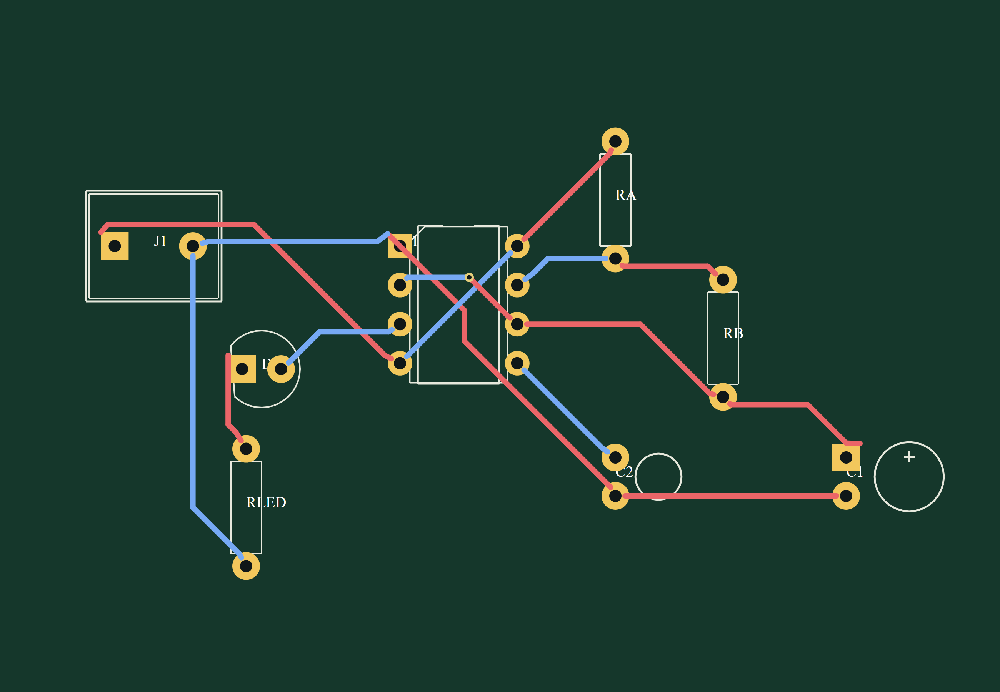
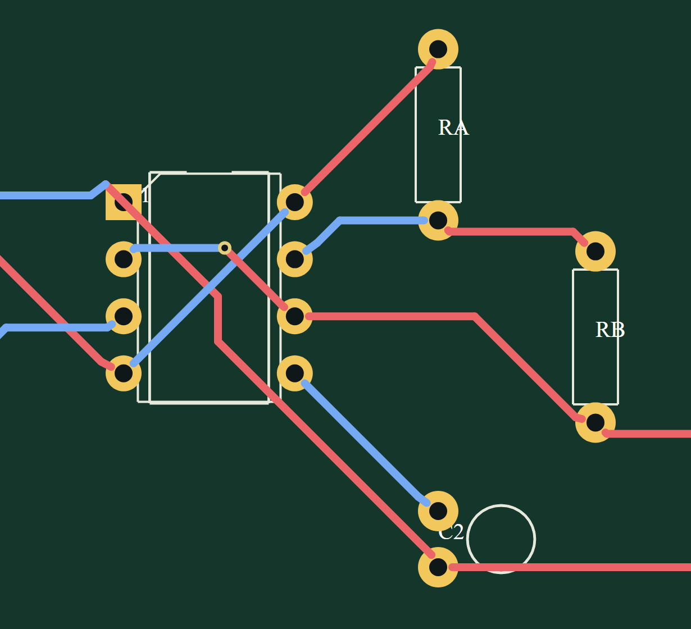

# ProtoCraft — Rust EDA, circuit simulator, and PCB design software

<p align="center"></p>

<p align="center"><strong>Electronic design automation (EDA) for schematic capture, circuit simulation, PCB layout, and manufacturing output — built in Rust.</strong></p>

<p align="center"><strong>English · Main README</strong> · <a href="README.pt-BR.md">Português · tradução</a></p>

ProtoCraft is a Rust desktop EDA application with a headless CLI. It combines a schematic editor, electrical rule checking (ERC), original DC and transient simulation engines, two-layer PCB layout and routing, and Gerber/Excellon manufacturing export. It includes experimental importers for selected Proteus and Falstad/CircuitJS files, physical catalogs for STM32, ESP32, and Raspberry Pi, plus CLI workflows for DFM, assembly variants, DC sweeps, and transient measurements.

ProtoCraft is an independent implementation. It does not bundle or require Proteus. Proteus import is partial, and embedded MCU firmware is not emulated.

> **Project status:** active development. Original ProtoCraft source code, documentation, and bundled circuit examples are available under MIT or Apache-2.0, at your option. Third-party data and assets have separate terms; see [NOTICE.md](NOTICE.md) and the license files.

## Capabilities

- **Schematic capture:** place and edit components, wire nets, run ERC, and use undo/redo plus Ctrl+C/Ctrl+X/Ctrl+V.
- **Circuit simulation:** three built-in Rust engines for DC and transient analysis, with plots and CSV output. Models are generic and educational.
- **PCB design:** two-layer board editing, manual tracks, vias, non-plated holes, design-rule checks (DRC), and an initial A* autorouter.
- **Manufacturing files:** RS-274X Gerber and Excellon drill output, with a JLCPCB preset. This optional workflow invokes an explicitly configured KiCad CLI.
- **Physical device design:** offline STM32/ESP32 package and pad data plus Raspberry Pi GPIO header and Pico pinouts. Firmware and on-chip peripherals are not simulated.
- **Project files and import:** native versioned `.protocraft` files; partial Proteus import; Falstad/CircuitJS text, XML, URL, and link import, with generic models and explicit simulation limits.
- **Advanced CLI workflows:** DFM reports, assembly variants, DC parameter sweeps, and transient measurements. These do not imply fabrication certification or complete SPICE/Proteus equivalence.
- **Desktop and automation:** light/dark desktop UI, English and Brazilian Portuguese translations, a headless CLI, and an MCP stdio server for project inspection, typed edits, device search, DRC, and autorouting.

## Example board built with ProtoCraft: 555 LED blinker

<p align="center"></p>

<p align="center"></p>

This two-layer astable 555 board was laid out and routed in ProtoCraft. It has 45 track segments, one via, 0.35 mm tracks, and 15 completed connections. Tracks approach the centers of the through-hole pads while keeping the drill openings clear. Open the [native project](examples/555-led-1hz-pcb.protocraft) or read the [board and fabrication notes](docs/555-led-1hz-pcb.md).

## Quick start

On Windows, run `Iniciar-ProtoCraft.cmd`. To build and launch from source, install the Rust toolchain pinned in `rust-toolchain.toml` and the MSVC C++ build tools, then run:

```powershell
cargo run -p eda-app
```

Run the headless CLI from the repository root with:

```powershell
cargo run -p eda-cli -- --help
cargo run -p eda-cli -- templates
cargo run -p eda-cli -- new --output blink.protocraft --template 555-led-1hz --frequency-hz 1
cargo run -p eda-cli -- simulate blink.protocraft --engine mixed --transient 0.00025 3 --csv blink.csv
cargo run -p eda-cli -- mcp --project blink.protocraft
```

See the complete [CLI guide](docs/cli.md), the [extended English guide](README.en.md), and the [Portuguese translation](README.pt-BR.md) for setup, commands, examples, and current limitations.

## Documentation map

- [Architecture and Rust crates](docs/architecture.md)
- [Craft architecture compatibility study](docs/craft-compatibility.md)
- [Native `.protocraft` file format](docs/file-format.md)
- [CLI commands and automation](docs/cli.md)
- [MCP server and tools](docs/mcp.md)
- [Simulation engines and validation](docs/simulation-engines.md) · [mixed analog/digital simulation](docs/mixed-simulation.md)
- [PCB routing and Gerber/Excellon export](docs/manual-routing.md)
- [STM32/ESP32 physical catalog](docs/mcu-pcb.md)
- [Proteus import scope and limitations](docs/proteus-import.md)
- [Roadmap](docs/roadmap.md) · [validation notes](docs/validation.md) · [v0.11.0 release notes](docs/release-notes-v0.11.0.md) · [third-party notices](NOTICE.md)

## Search terms / Palavras-chave

Rust EDA, electronic design automation, circuit simulator, schematic capture, circuit design, PCB layout, PCB routing, PCB autorouter, Gerber RS-274X, Excellon drill files, SPICE netlist export, STM32, ESP32, Proteus project importer, `.protocraft`, headless CLI; EDA em Rust, automação de projetos eletrônicos, simulador de circuitos, captura de esquemáticos, projeto de PCB, roteamento de placas.

AI-oriented repository index: [`llms.txt`](llms.txt).
