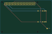
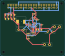

# ProtoCraft

<p align="center"></p>

<p align="center"><strong>Português · tradução</strong> · <a href="README.md">English · README principal</a></p>

Editor de circuitos eletrônicos para desktop, feito em Rust. Reúne editor de esquemas, motores próprios de simulação, roteamento manual e autorroteamento inicial de PCB em duas camadas, catálogos físicos STM32/ESP32/Raspberry Pi, CLI e importadores experimentais de projetos Proteus e Falstad/CircuitJS.

> **Estado do projeto:** em desenvolvimento ativo. O código-fonte, a documentação e os exemplos de circuitos originais distribuídos com o ProtoCraft são licenciados sob MIT ou Apache-2.0, à sua escolha. Dados e assets de terceiros têm termos próprios; consulte [NOTICE.md](NOTICE.md), [LICENSE-MIT](LICENSE-MIT) e [LICENSE-APACHE](LICENSE-APACHE).

## Destaques

- Editor esquemático com fios, rótulos de rede, ERC, desfazer/refazer e copiar/recortar/colar componentes.
- Três motores próprios de simulação, análise transiente, gráficos e exportação CSV.
- Editor PCB de duas camadas com trilhas manuais, autorroteador A* inicial, vias, furos não metalizados e DRC.
- Classes de rede com folga/largura mínima e dimensões de via aplicadas ao DRC e ao autorroteador; galeria nativa de projetos PCB básicos e complexos no desktop e na CLI.
- Fluxo inicial de fontes chaveadas: calculadora de buck limitada ao LM61460, projeto de referência 12 V → 5,1 V / 3 A para Raspberry Pi 4 e regras de rede para trilhas de potência.
- Exportação Gerber/Excellon com preset JLCPCB e validação pelo KiCad CLI externo.
- Catálogo físico offline com 2.283 entradas STM32, 48 Espressif e 27 pinagens Raspberry Pi: headers clássicos de 40/26 pinos e famílias Pico/Pico 2.
- CLI para validação, netlists, simulação, exportação SPICE, autorroteamento, ações de projeto e importação Proteus.
- Servidor MCP headless por stdio com comandos tipados, busca física facetada, DRC e autorroteamento com revisão esperada.
- Interface e CLI em português do Brasil e inglês, com seleção pelo idioma do sistema e fallback para inglês; os catálogos JSON podem ser substituídos sem recompilar.
- Importação de Falstad/CircuitJS por texto legado, XML, .url e link HTTPS. Dispositivos reconhecidos usam modelos genéricos; itens sem suporte bloqueiam a simulação e aparecem no relatório.
- Fluxos avançados de CLI para relatórios DFM, variantes de montagem, varredura DC de uma fonte/resistor e medições transientes. Consulte [fluxos avançados](docs/advanced-workflows.md) e seus limites.
- Formato nativo de projeto `.protocraft`.

## Placa construída no ProtoCraft: pisca-pisca com 555

<p align="center"></p>

<p align="center"></p>

Esta placa astável de duas camadas foi posicionada e roteada no ProtoCraft. Ela tem 45 segmentos de trilha, uma via, trilhas de 0,35 mm e 15 conexões concluídas. As trilhas chegam na direção do centro dos pads passantes, mantendo as furações livres. Abra o [projeto nativo](examples/555-led-1hz-pcb.protocraft) ou consulte as [notas da placa e da fabricação](docs/555-led-1hz-pcb.md).

## Shield GPIO para Raspberry Pi 4

<p align="center"></p>

Este exemplo nativo de duas camadas tem contorno arredondado de 85 × 56 mm, quatro furos de montagem, header GPIO 2×20, ponto de teste GPIO17 e LEDs indicadores de 5 V/3,3 V. O projeto salvo informa 49 pads, 299,56 mm de cobre roteado, nenhum diagnóstico DRC e nenhum airwire na CLI atual. É um protótipo verificado por software: o encaixe físico não foi confirmado, e a placa de 85 mm pode interferir nos conectores ou no gabinete do Pi. Abra o [projeto nativo](examples/raspberry-pi-4-shield.protocraft) e consulte as [notas mecânicas e elétricas](docs/raspberry-pi-4-shield-prototype.md).

## Fonte buck para Raspberry Pi 4 · 12 V para 5,1 V / 3 A

<p align="center"></p>

O projeto de referência de 65 × 56,5 mm usa o controlador buck LM61460 e trilhas nominais de 0,8 mm nas redes de potência. O arquivo salvo informa 98 pads, 493,54 mm de cobre roteado, nenhum diagnóstico DRC e nenhum airwire na CLI atual. O SVG é uma prévia gerada pelo renderizador de PCB, não uma captura da interface desktop. O projeto não tem simulação de comutação, validação térmica/EMI, revisão independente de fabricação ou teste físico com carga; o DRC geométrico não certifica operação a 3 A. Abra o [projeto nativo](examples/pcb-pi4-12v-buck.protocraft) e consulte os [cálculos e limites do projeto](docs/power-conversion.md).

## Início rápido

No Windows, execute `Iniciar-ProtoCraft.cmd`. Para compilar o código-fonte, instale a toolchain Rust indicada em `rust-toolchain.toml` e as ferramentas de build C++ MSVC, depois execute:

```powershell
cargo run -p eda-app
```

Consulte o [README principal em inglês](README.md) ou o [guia completo de build e CLI em inglês](README.en.md).

## CLI

Execute os comandos a partir da raiz do repositório com `cargo run -p eda-cli --`, ou use `ProtoCraft-CLI.cmd` no Windows:

```powershell
cargo run -p eda-cli -- --help
cargo run -p eda-cli -- templates
cargo run -p eda-cli -- new --output pisca.protocraft --template 555-led-1hz --frequency-hz 1
cargo run -p eda-cli -- simulate pisca.protocraft --engine mixed --transient 0.00025 3 --csv pisca.csv
cargo run -p eda-cli -- mcp --project pisca.protocraft
```

Consulte o [guia da CLI](docs/cli.md) e o [guia do MCP](docs/mcp.md) para inspeção, edição atômica, validação, autorroteamento, fabricação e importação. O MCP mantém uma sessão headless própria do arquivo indicado; ainda não controla a janela desktop aberta.

Para criar pelo CLI o shield de exemplo para Raspberry Pi 4 Model B, use `raspberry-pi-4-shield --output shield-pi4.protocraft`. O comando cria a placa de 85 × 56 mm com cantos arredondados, furação de montagem, header GPIO de 40 pinos, um ponto de teste identificado para GPIO17 e LEDs indicadores ligados a 5 V e 3,3 V. Consulte o [guia do shield](docs/raspberry-pi-4-shield-prototype.md) para pinagem, fabricação e limites mecânicos.

Para gerar a placa de fonte chaveada de 12 V para 5,1 V / 3 A, use `power-design buck` para obter o cálculo de primeira ordem, `power-design copper` para estimar largura por corrente/queda DC e `buck-pi4-12v --output pi4-buck.protocraft` para criar e rotear o exemplo. O projeto injeta alimentação pelos pinos 5 V do GPIO; nunca conecte simultaneamente uma fonte USB-C ao Pi. Consulte [projeto e limites do conversor](docs/power-conversion.md); o DRC geométrico não demonstra segurança elétrica, térmica ou EMI.

O catálogo também oferece os modelos Raspberry Pi com header GPIO de 40 pinos, as revisões legadas de 26 pinos e todas as variantes de pinagem Pico/Pico 2. Use `devices --filter "Raspberry Pi"` para listar e `device "Raspberry Pi Pico 2 W"` para consultar uma pinagem e seu footprint. `raspberry-pi-hat --output hat.protocraft` cria uma base mecânica no formato HAT de 65 × 56 mm. Esse template não inclui EEPROM nem certificação elétrica HAT+; os Compute Modules permanecem fora do catálogo por usarem conectores e mapas de carrier diferentes. Consulte [catálogo e limites Raspberry Pi](docs/raspberry-pi-catalog.md).

## Escopo e limitações

Os novos fluxos de CLI oferecem [tentativas alternativas de rota, limpeza colinear e revisão DFM](docs/pcb-optimization.md), com orçamento de trabalho, identificação de objetos e limites de fabricação configuráveis.

O ProtoCraft implementa seus próprios motores e não incorpora código nem binários do Proteus. A importação `.pdsprj`/`.dsn` é experimental e parcial; não há garantia de compatibilidade com todos os projetos Proteus. Os dados de STM32/ESP32 servem ao projeto físico: firmware e periféricos internos não são emulados. Os modelos de simulação são genéricos e educacionais. A exportação para fabricação exige KiCad CLI e revisão independente da placa antes da produção.

Consulte as [notas da versão 0.11.1](docs/release-notes-v0.11.1.md) para as mudanças desta publicação.

## Termos de busca

EDA em Rust, automação de projetos eletrônicos, software EDA, captura de esquemáticos, simulador de circuitos, análise DC, análise transiente, projeto e roteamento de PCB, autorroteador, Gerber RS-274X, Excellon, netlist SPICE, STM32, ESP32, importação de projetos Proteus, formato `.protocraft`, CLI headless.

## Criar e simular o exemplo 555 de 1 Hz

Na raiz do repositório, o atalho `ProtoCraft-CLI.cmd` compila a CLI e permite começar um circuito a partir de um modelo:

```powershell
ProtoCraft-CLI.cmd templates
ProtoCraft-CLI.cmd new --template 555-led-1hz --frequency-hz 1 --output pisca.protocraft --open
ProtoCraft-CLI.cmd simulate pisca.protocraft --engine mixed --transient 0.00025 3 --csv pisca.csv
```

O projeto inicial usa RA=47 kΩ, RB=47 kΩ, LED com resistor limitador de 680 Ω e capacitor de bypass de 10 nF. O comando calcula C1 para a frequência informada, grava o `.protocraft`, abre o editor e permite salvar os sinais da simulação em CSV. Use `--c-farads` no lugar de `--frequency-hz` para definir diretamente o capacitor. Consulte o [guia da CLI](docs/cli.md) para criar projetos vazios, listar os outros modelos e ver os limites.

## Construção de PCB: ferramentas adicionais

A [documentação dos fluxos PCB](docs/pcb-workflows.md) explica a sincronização de footprints, movimento com trilhas conectadas, remoção de duplicatas, métricas por rede e relatórios de materiais/posições de montagem. Esses fluxos usam o mesmo domínio pelo desktop e pela CLI e conservam as limitações descritas no guia.

O menu **Exemplos → Exemplos de PCB** contém projetos nativos básicos e complexos, incluindo uma placa 555 roteada, um layout STM32/ESP32 para experimentar o autorroteador, um shield Raspberry Pi 4 e o conversor buck de 3 A. O comando `ProtoCraft-CLI.cmd examples projetos\galeria` exporta a galeria completa para arquivos `.protocraft`; veja [os exemplos e seus estados iniciais](docs/pcb-examples.md).
