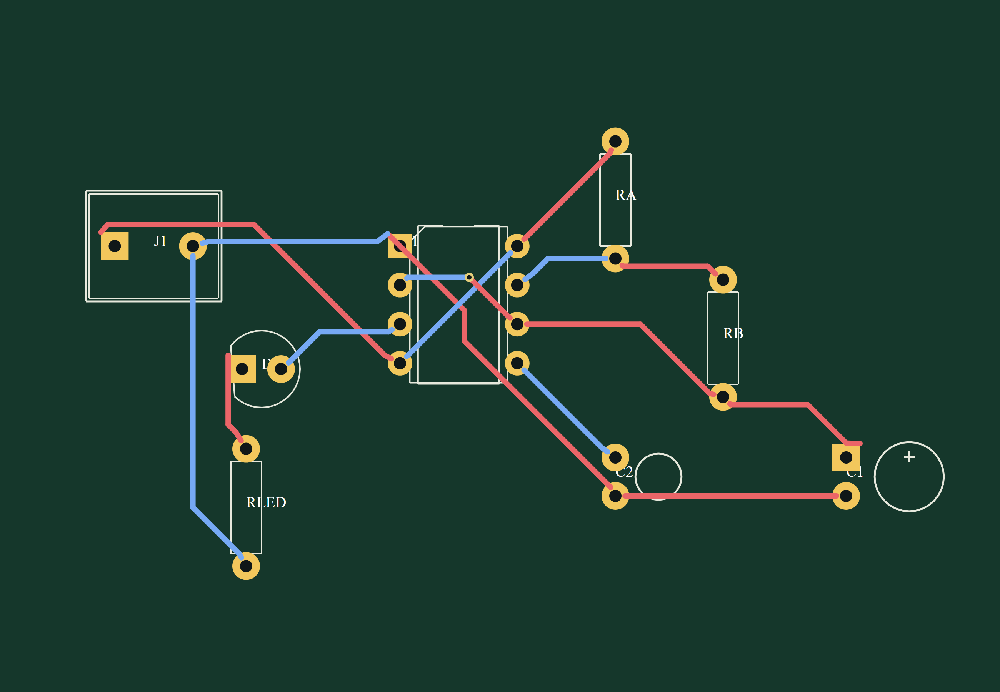
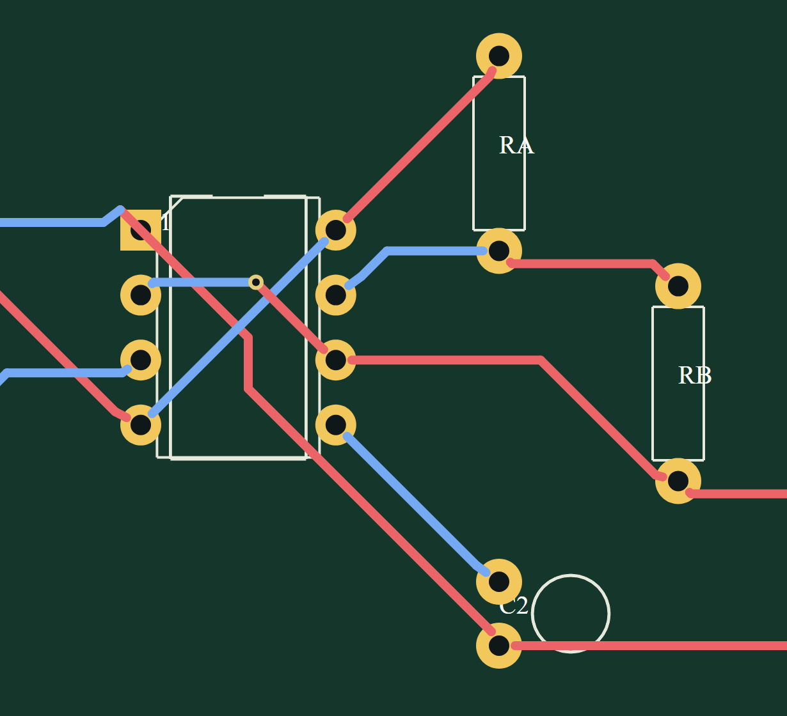

# ProtoCraft

<p align="center"></p>

<p align="center"><strong>Português · tradução</strong> · <a href="README.md">English · README principal</a></p>

Editor de circuitos eletrônicos para desktop, feito em Rust. Reúne editor de esquemas, motores próprios de simulação, roteamento manual e autorroteamento inicial de PCB em duas camadas, dados físicos de dispositivos STM32/ESP32, CLI e importador experimental de projetos Proteus.

> **Estado do projeto:** em desenvolvimento ativo. O código-fonte, a documentação e os exemplos de circuitos originais distribuídos com o ProtoCraft são licenciados sob MIT ou Apache-2.0, à sua escolha. Dados e assets de terceiros têm termos próprios; consulte [NOTICE.md](NOTICE.md), [LICENSE-MIT](LICENSE-MIT) e [LICENSE-APACHE](LICENSE-APACHE).

## Destaques

- Editor esquemático com fios, rótulos de rede, ERC, desfazer/refazer e copiar/recortar/colar componentes.
- Três motores próprios de simulação, análise transiente, gráficos e exportação CSV.
- Editor PCB de duas camadas com trilhas manuais, autorroteador A* inicial, vias, furos não metalizados e DRC.
- Exportação Gerber/Excellon com preset JLCPCB e validação pelo KiCad CLI externo.
- Catálogo físico offline com 2.283 entradas STM32 e 48 Espressif.
- CLI para validação, netlists, simulação, exportação SPICE, autorroteamento, ações de projeto e importação Proteus.
- Servidor MCP headless por stdio com comandos tipados, busca física facetada, DRC e autorroteamento com revisão esperada.
- Interface e CLI em português do Brasil e inglês, com seleção pelo idioma do sistema e fallback para inglês; os catálogos JSON podem ser substituídos sem recompilar.
- Formato nativo de projeto `.protocraft`.

## Placa construída no ProtoCraft: pisca-pisca com 555

<p align="center"></p>

<p align="center"></p>

Esta placa astável de duas camadas foi posicionada e roteada no ProtoCraft. Ela tem 45 segmentos de trilha, uma via, trilhas de 0,35 mm e 15 conexões concluídas. As trilhas chegam na direção do centro dos pads passantes, mantendo as furações livres. Abra o [projeto nativo](examples/555-led-1hz-pcb.protocraft) ou consulte as [notas da placa e da fabricação](docs/555-led-1hz-pcb.md).

## Início rápido

No Windows, execute `Iniciar-ProtoCraft.cmd`. Para compilar o código-fonte, instale a toolchain Rust indicada em `rust-toolchain.toml` e as ferramentas de build C++ MSVC, depois execute:

```powershell
cargo run -p eda-app
```

Consulte o [README principal em inglês](README.md) ou o [guia completo de build e CLI em inglês](README.en.md).

## CLI

Execute os comandos a partir da raiz do repositório com `cargo run -p eda-cli --`, ou use `ProtoCraft-CLI.cmd` no Windows:

```powershell
cargo run -p eda-cli -- --help
cargo run -p eda-cli -- templates
cargo run -p eda-cli -- new --output pisca.protocraft --template 555-led-1hz --frequency-hz 1
cargo run -p eda-cli -- simulate pisca.protocraft --engine mixed --transient 0.00025 3 --csv pisca.csv
cargo run -p eda-cli -- mcp --project pisca.protocraft
```

Consulte o [guia da CLI](docs/cli.md) e o [guia do MCP](docs/mcp.md) para inspeção, edição atômica, validação, autorroteamento, fabricação e importação. O MCP mantém uma sessão headless própria do arquivo indicado; ainda não controla a janela desktop aberta.

## Escopo e limitações

O ProtoCraft implementa seus próprios motores e não incorpora código nem binários do Proteus. A importação `.pdsprj`/`.dsn` é experimental e parcial; não há garantia de compatibilidade com todos os projetos Proteus. Os dados de STM32/ESP32 servem ao projeto físico: firmware e periféricos internos não são emulados. Os modelos de simulação são genéricos e educacionais. A exportação para fabricação exige KiCad CLI e revisão independente da placa antes da produção.

## Termos de busca

EDA em Rust, automação de projetos eletrônicos, software EDA, captura de esquemáticos, simulador de circuitos, análise DC, análise transiente, projeto e roteamento de PCB, autorroteador, Gerber RS-274X, Excellon, netlist SPICE, STM32, ESP32, importação de projetos Proteus, formato `.protocraft`, CLI headless.

## Criar e simular o exemplo 555 de 1 Hz

Na raiz do repositório, o atalho `ProtoCraft-CLI.cmd` compila a CLI e permite começar um circuito a partir de um modelo:

```powershell
ProtoCraft-CLI.cmd templates
ProtoCraft-CLI.cmd new --template 555-led-1hz --frequency-hz 1 --output pisca.protocraft --open
ProtoCraft-CLI.cmd simulate pisca.protocraft --engine mixed --transient 0.00025 3 --csv pisca.csv
```

O projeto inicial usa RA=47 kΩ, RB=47 kΩ, LED com resistor limitador de 680 Ω e capacitor de bypass de 10 nF. O comando calcula C1 para a frequência informada, grava o `.protocraft`, abre o editor e permite salvar os sinais da simulação em CSV. Use `--c-farads` no lugar de `--frequency-hz` para definir diretamente o capacitor. Consulte o [guia da CLI](docs/cli.md) para criar projetos vazios, listar os outros modelos e ver os limites.
