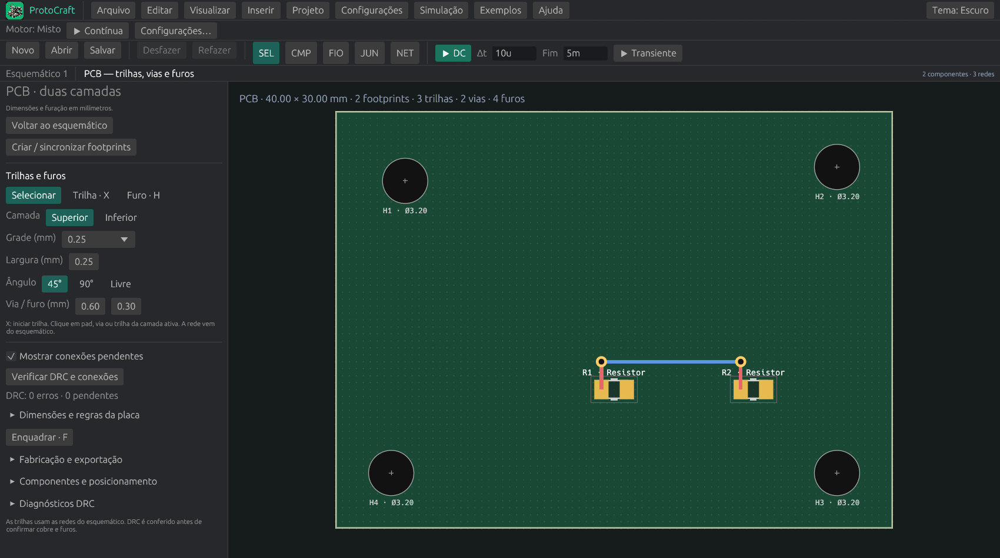

# Trilhas, vias e furos — ProtoCraft 0.6

Abra **Visualizar → PCB — dimensões reais**. Se ainda não houver placa, use **Criar / sincronizar footprints**. Uma placa sem componentes também pode receber furos mecânicos. As ferramentas ficam no início do painel lateral; dimensões, posicionamento e fabricação estão em seções expansíveis.

Uma [placa de exemplo](examples/pcb-trilhas-furos.protocraft) está incluída em `docs/examples/`: 40 × 30 mm, dois resistores, trilhas nas duas faces, duas vias e quatro furos NPTH. Abra o arquivo e ative a visualização PCB, ou execute `protocraft.exe docs/examples/pcb-trilhas-furos.protocraft --pcb`. É uma demonstração de PCB, sem fonte/terra para simulação.



## Roteamento manual

1. Defina no esquemático quais pinos pertencem à mesma rede; a PCB usa essa conectividade.
2. Escolha **Superior** ou **Inferior**, largura da trilha e grade em mm.
3. Selecione **Trilha** ou pressione **X**. Clique num pad, via ou trilha da camada ativa para começar. Pads da face oposta não iniciam uma trilha nesta camada; terminais passantes e vias pertencem às duas.
4. Mova o cursor para ver a prévia. Escolha **45°**, **90°** ou **Livre**. **Espaço** inverte a ordem da dobra. A ferramenta desenha somente os segmentos definidos pelo cursor; não procura caminhos nem desvia de obstáculos.
5. Clique para confirmar um ou dois segmentos de uma vez. O encaixe usa o centro exato dos pads/vias e o ponto próximo de uma trilha, inclusive fora da grade.
6. Clique em cobre da mesma rede para terminar a conexão. Um destino de outra rede é indicado em vermelho e recusado.

**Esc** ou clique direito encerra a prévia atual; os segmentos já confirmados permanecem. Outro Esc volta à seleção. **Backspace** desfaz o último passo da rota atual; **Ctrl+Z/Ctrl+Y** fazem undo/redo e encerram a prévia. Cada clique que confirma segmentos é uma edição atômica.

O DRC recusa novas violações físicas, como curto, folga insuficiente, borda ou área de exclusão. Conexões ainda pendentes não impedem continuar a placa; aparecem nas linhas de ligação e no relatório. Erros físicos anteriores independentes podem continuar visíveis enquanto outras áreas são corrigidas. Não há afastamento automático de trilhas.

## Autorroteamento inicial

Use **Autorrotear conexões pendentes** no painel da PCB. A busca roda em segundo plano e o resultado só é aplicado se a placa não tiver sido editada enquanto o cálculo ocorria. O lote inteiro entra no histórico como uma edição única, para que **Ctrl+Z** desfaça todas as rotas de uma vez.

O motor em Rust trabalha nas duas camadas com uma busca octilinear A* em malha local esparsa. Ele considera pads, trilhas, vias, furos, áreas de exclusão, folga, largura, curvas e custo de troca de camada. Ordena as ligações mais longas primeiro, tenta uma resolução refinada quando a primeira busca falha e faz uma passada limitada de melhoria das rotas encontradas. Orçamentos por conexão e globais limitam as expansões. As rotas planejadas passam pelo DRC antes de serem aceitas; um novo erro físico cancela o lote.

Também há uma operação de CLI que preserva o projeto de entrada e grava um novo arquivo:

```powershell
protocraft-cli pcb-route placa.protocraft --output placa-roteada.protocraft
protocraft-cli pcb-route placa.protocraft --output placa-roteada.protocraft --grid-mm 0.25 --track-width-mm 0.25 --max-expansions 600000 --no-optimize
```

O relatório JSON informa conexões roteadas, rotas pendentes, trilhas, vias, comprimento, expansões e falhas individuais. O autorroteador atual cobre placas retangulares de duas camadas; ainda não faz rip-up de trilhas manuais, zonas de cobre, pares diferenciais, controle de impedância ou regras por classe de rede. Para essas situações, revise o resultado e execute **Verificar DRC e conexões** antes de fabricar.

## Vias e troca de camada

Configure **Via / furo (mm)**: o primeiro valor é o diâmetro do cobre; o segundo é a furação. O padrão é 0,6/0,3 mm. O furo deve ser menor que o diâmetro, com anel mínimo de 0,1 mm no DRC inicial.

Durante uma rota, pressione **V** com o cursor sobre a PCB: a ferramenta confirma os segmentos até esse ponto, coloca uma via metalizada e troca a camada. O botão **Via neste ponto** coloca no último ponto confirmado. Uma via ou pad passante já existente da mesma rede é reutilizado, sem duplicar a furação. A troca direta pelo seletor de camada é bloqueada durante uma rota ativa; use uma via ou encerre a rota antes de escolher outra face.

Uma via faz parte de uma rede. Para começar a partir de uma via existente, escolha a ferramenta Trilha e clique nela. Não há vias cegas ou enterradas nesta versão.

## Furos de fixação

1. Selecione **Furo** ou pressione **H**.
2. Ajuste **Furo NPTH (mm)**, por exemplo 3,2 mm para a passagem nominal de um parafuso M3.
3. Clique na posição desejada. O encaixe usa a grade escolhida. A ferramenta permanece ativa para colocar outros furos.
4. Pressione **Esc** e selecione um furo para editar X, Y e diâmetro ou excluí-lo.

São furos **circulares não metalizados**, sem pads de cobre e sem ligação elétrica. O domínio aceita diâmetros de 0,1 a 50 mm; isso é um intervalo do editor, não uma declaração de capacidade da fábrica. A ferramenta não reserva automaticamente espaço para cabeça, porca ou espaçador.

O DRC confere furo–cobre, furo–furo, distância à borda e furos mecânicos dentro de áreas de exclusão. Furos ovais de footprints são considerados por uma envoltória circular conservadora na verificação local. Furos próprios de pads passantes e vias são diferenciados do cobre que devem conectar.

## Selecionar, mover e editar

Volte a **Selecionar**. Clique numa trilha da camada ativa, via ou furo para abrir seu inspetor:

Para componentes, **Ctrl+C / Ctrl+X / Ctrl+V** também funcionam na PCB. Copiar duplica o componente lógico e o footprint; recortar reposiciona o footprint existente, preservando sua identidade e o esquema. Consulte [o guia do clipboard](clipboard.md). Os atalhos com Ctrl não acionam as ferramentas X/V de trilha/via.

- **Trilha:** início/fim XY, largura e camada.
- **Via:** XY, diâmetro de cobre e furação.
- **Furo NPTH:** XY e diâmetro.

Clique em **Aplicar edição** para confirmar. Também é possível arrastar a geometria; a prévia fica destacada e a alteração é confirmada ao soltar, após DRC. Arrastar um trecho desloca as duas extremidades. **Del** exclui a seleção; as operações suportam undo/redo.

Mover cobre ou componentes pode abrir conexões com os trechos vizinhos: eles não acompanham automaticamente o movimento. As conexões pendentes são recalculadas; reconecte-as com a ferramenta Trilha. Pan com botão do meio/direito, zoom com roda e **F** para enquadrar.

## Salvar e fabricar

Trilhas, vias e furos ficam no mesmo `.protocraft` v6. Arquivos v1–v5 são migrados, com lista vazia de furos mecânicos quando ausente. Os comandos da CLI compartilham o Engine e estão em [cli.md](cli.md#edição-de-trilhas-e-furos).

Em **Fabricação e exportação**, o preset JLCPCB mantém RS-274X/Protel, mm, escala 1:1 e origem absoluta. Vias/pads metalizados saem no Excellon PTH; os furos mecânicos saem no NPTH. O ZIP inclui Gerbers e os dois tipos de furação. A exportação KiCad e a prévia SVG também preservam os furos. A fabricação exige aprovação dos DRCs nativo e externo.
